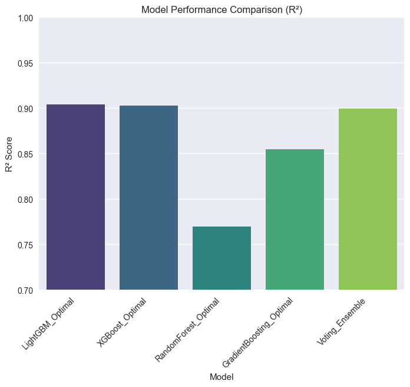
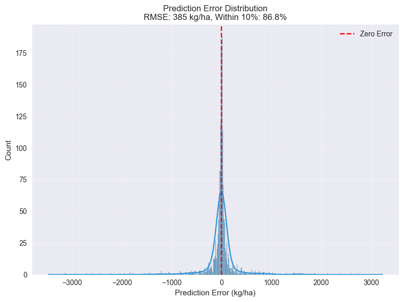
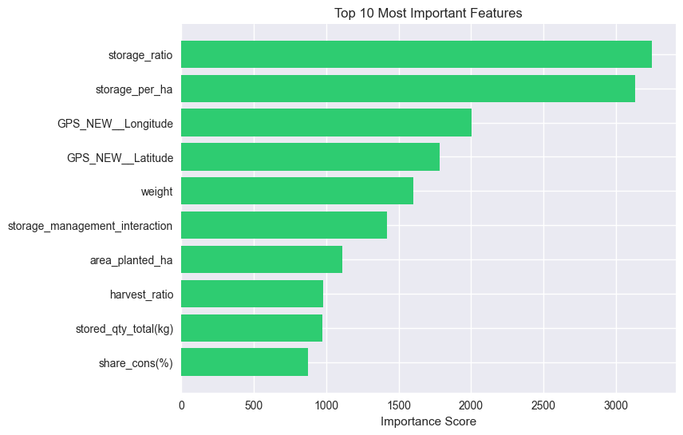
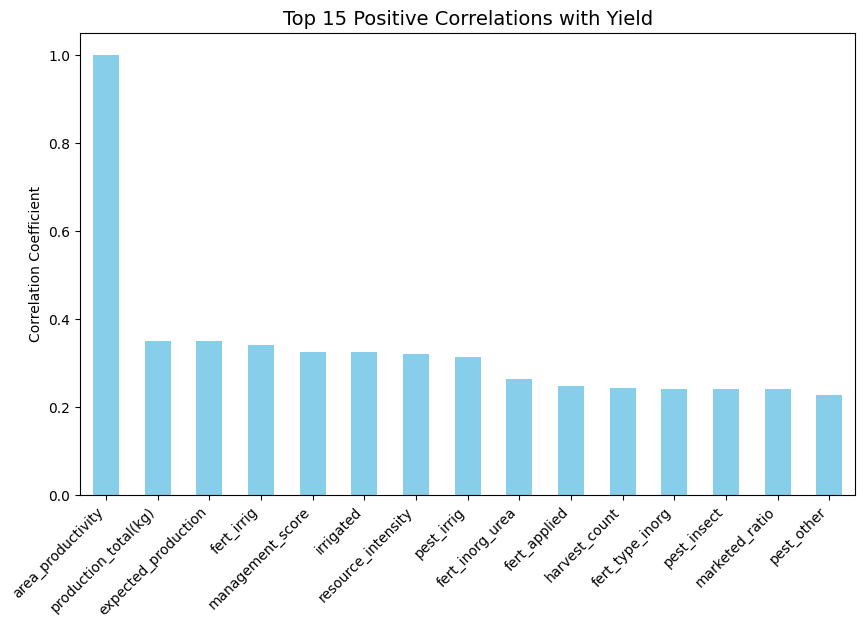

# Cambodia Rice Yield Forecasting

An applied data science research project on Cambodian rice-yield forecasting, agricultural statistics, machine learning, and regional agricultural visualization, developed from my previous research experience at the National Institute of Statistics, Cambodia.

> **Read this first: what this repository is and is not**
>
> - It documents research I carried out during a research internship at the **National Institute of Statistics (NIS), Cambodia**, using **Cambodia Agriculture Survey (CAS) 2024** holding-level data.
> - **The survey data are confidential and are not included.** Neither are record-level predictions, descriptive survey estimates (province or zone results), or maps. The notebooks therefore **cannot be run from this repository alone**. See [data/README.md](data/README.md).
> - **No trained model files were found or saved**, so none are published.
> - "Forecasting" here means **predictive modelling on held-out survey records** (a cross-sectional, parcel-level analysis). It is **not** a time-series forecast of future yields.
> - **Two of the three recorded results have validity problems**, found by an independent review while packaging this repository: target leakage in notebook 05 and in notebook 04's `storage_ratio` feature. Only notebook 06 is leakage-free by construction. Details: [reports/validity_review.md](reports/validity_review.md). I did **not** re-run or re-tune anything: numbers are exactly as recorded in the original notebooks.
> - NIS permission to publish has **not** been confirmed, so this repository publishes only code with outputs removed, aggregate model-performance metrics, and a small set of model-performance charts.

## 1. Project overview

The work predicts, for individual rice parcels reported in the survey, (a) **yield** in kg/ha and (b) **total production** in kg, from farm-management and context variables: fertiliser and pesticide use, irrigation, planted and harvested area, harvest count, losses and their reasons, storage and use of the harvest, agro-ecological zone and location. Four tree-ensemble learners were compared (LightGBM, XGBoost, Random Forest, Gradient Boosting) plus a voting ensemble.

| Component | Where |
|---|---|
| Data extraction and preparation code | `notebooks/01`, `notebooks/02` |
| Exploratory visualisation code (charts withheld) | `notebooks/03` |
| Yield prediction | `notebooks/04` (leakage flagged) |
| Production prediction, first version | `notebooks/05` (**superseded, leaky**) |
| Production prediction, corrected | `notebooks/06` (leakage-free) |
| Recorded results | [reports/results_summary.md](reports/results_summary.md) |
| Validity review | [reports/validity_review.md](reports/validity_review.md) |
| Published charts | [visualizations/](visualizations/) |

## 2. Research background

Reliable estimates of crop yield and production support agricultural planning. National agricultural surveys such as the CAS collect parcel-level information on inputs, area and harvest. This project explores how well such survey-reported practices predict rice yield and production for individual parcels, and how sensitive the answer is to modelling choices, including data leakage.

## 3. Problem statement

Given survey-reported inputs and conditions for a rice parcel, how accurately can machine-learning models predict the parcel's yield (kg/ha) and production (kg) on records not used for training? (As reflected in the notebooks' targets and evaluation.)

## 4. Research objectives

As reflected in the notebooks:

1. Prepare parcel-level rice records from the CAS 2024 tables.
2. Compare gradient-boosting and bagging learners for yield and for production.
3. Evaluate with R-squared, RMSE, MAE, MAPE and share of predictions within a tolerance, plus 5-fold cross-validation on the training set.
4. Examine leakage and correct it (notebook 05 to 06).

## 5. Datasets

| Dataset | Description | Public here? |
|---|---|---|
| CAS 2024 main file | Holding-level survey data (Stata/CSV). Contains personal fields such as names and contacts, village identifiers and GPS coordinates | **No (confidential)** |
| CAS 2024 crop module (`S4_CROP`) | Parcel-crop records: area planted and harvested, production, yield, inputs, losses, storage and use | **No (confidential)** |
| Modelling table (`final_dataset.csv`) | About 11.7 thousand parcel records and 85 columns (rice crop codes 101, 102, 103: non-aromatic, aromatic and sticky paddy) | **No (confidential)** |
| Record-level predictions (`*_predictions.csv`) | Actual versus predicted values for held-out records | **No (withheld)** |

A data dictionary of the modelling table's column groups is in [docs/data_dictionary.md](docs/data_dictionary.md). No data of any kind is committed.

## 6. Data preprocessing

As implemented in the notebooks (see [docs/methodology.md](docs/methodology.md) for detail):

- Extraction of survey sections from Stata files and renaming of coded columns (notebook 01).
- Merging of crop, holding and location tables and mapping of provinces to four agro-ecological zones (notebook 02).
- Removal of identifiers; for the yield model, removal of `production_total(kg)` as a leakage guard.
- Outlier handling: yield restricted to 300-6,000 kg/ha (237 records removed) in notebook 04; production restricted to 30-10,000 kg (1,324 records, 11.27%, removed as IQR outliers) in notebook 06. **Results therefore apply only to those ranges.**
- Feature engineering (area ratios, stress counts, interaction terms, GPS-based clusters), removal of constant and highly correlated (above 0.90) features, median imputation, standard scaling and one-hot encoding.

## 7. Agricultural data analysis

Notebook 03 produces descriptive analysis and maps by crop, fertiliser type, zone and province from the survey. **Those outputs are descriptive survey estimates from confidential data and are intentionally not published.** The code is included with all outputs removed.

## 8. Machine-learning methodology

- **Models:** LightGBM, XGBoost, Random Forest, Gradient Boosting; a voting ensemble of the top three in notebook 04.
- **Hyperparameters:** fixed values set in the code (for example 400 to 500 trees, learning rate 0.05, depth 6 to 20). **No automated hyperparameter search was run**: `optuna` and `RandomizedSearchCV` are imported but never used.
- **Split:** 85/15 train/test, `random_state=42`, stratified by agro-ecological zone. The split is at **parcel level**, so parcels from the same holding can fall on both sides (see the validity review).
- **Validation:** 5-fold cross-validation on the training set (R-squared).

## 9. Model comparison (recorded results)

All numbers are copied from the original notebooks' recorded outputs. Test-set values unless stated.

**Yield (kg/ha), notebook 04. Optimistic: leakage flagged.** Test n = 1,724.

| Model | R-squared | CV R-squared (mean +/- sd) | RMSE | MAE |
|---|---|---|---|---|
| LightGBM | 0.9044 | 0.9092 +/- 0.0022 | 385.02 | 153.98 |
| XGBoost | 0.9030 | 0.9058 +/- 0.0026 | 387.72 | 156.64 |
| Voting ensemble | 0.8994 | not computed | 394.80 | 178.14 |
| Gradient Boosting | 0.8550 | 0.8482 +/- 0.0052 | 474.10 | 269.11 |
| Random Forest | 0.7695 | 0.7538 +/- 0.0044 | 597.67 | 381.31 |

Best model (LightGBM): MAPE 8.08%; 86.8% of predictions within 10%. R-squared was **negative (-0.757) for low-yield parcels (< 1,667 kg/ha)** and 0.591 for high-yield parcels (> 3,333 kg/ha), so the headline R-squared hides weak performance at low yields.

**Production (kg), notebook 06. Leakage-free.** Train 8,126; test 1,435.

| Model | R-squared | CV R-squared (mean +/- sd) | RMSE (kg) | MAE (kg) |
|---|---|---|---|---|
| XGBoost | 0.8382 | 0.8060 +/- 0.0123 | 758.83 | 406.56 |
| LightGBM | 0.8352 | 0.8058 +/- 0.0122 | 765.91 | 411.16 |
| Gradient Boosting | 0.8301 | 0.8044 +/- 0.0159 | 777.58 | 447.46 |
| Random Forest | 0.8077 | 0.7879 +/- 0.0127 | 827.32 | 471.71 |

Best model (XGBoost): MAPE 19.44%; **68.9% of predictions within 20%**.

**Production, notebook 05 (superseded, leaky):** R-squared 0.9998, MAE 10 kg, 99.8% within 20%. This is an artefact of leakage and **must not be cited as model performance**. The drop from 0.9998 to 0.838 after the fix (notebook 06) shows the size of the effect.

## 10. Evaluation metrics

R-squared, RMSE, MAE, MAPE (mean absolute percentage error), the share of predictions within a percentage tolerance (10% for yield, 20% for production), and 5-fold cross-validated R-squared. A single random 85/15 split was used for the reported test results.

## 11. Visualisation results

Published charts show model performance and the leakage evidence only. See [visualizations/README.md](visualizations/README.md) for what each shows and what was withheld.

| Yield model comparison (R-squared) | Yield prediction error distribution |
|---|---|
|  |  |

| Yield feature importance (note `storage_ratio`: leakage) | Production v5: correlation with yield (note `area_productivity` = 1.0) |
|---|---|
|  |  |

## 12. Research findings

What the recorded results support:

1. **Gradient-boosting methods (LightGBM, XGBoost, Gradient Boosting) outperformed Random Forest** for both yield and production in these runs. In the leakage-free production experiment the gap was small (R-squared 0.808 to 0.838).
2. **For parcel-level production, a leakage-free model reached R-squared 0.84 and a mean percentage error of 19%** on a random held-out sample, with about two thirds of predictions within 20%.
3. **Leakage can make a model look near-perfect.** Moving from the leaky to the corrected production model reduced R-squared from 0.9998 to 0.838.

What they do **not** support: the yield result (R-squared 0.904) should not be taken as a reliable generalisation estimate, and none of the results demonstrate prediction for new holdings, new provinces or future seasons, because the evaluation used random parcel-level splits from a single survey year. No causal claims are made.

## 13. Limitations

See [docs/limitations.md](docs/limitations.md). In brief: leakage (notebooks 04 and 05), random parcel-level splits, truncated target ranges, a single survey year, no saved models, an incomplete preparation chain (see section 14), no automated tuning, and confidential data that prevents reproduction here.

## 14. Installation and reproduction

```bash
pip install -r requirements.txt     # library versions used at NIS were not recorded; see the note in the file
pytest                              # repository checks: no outputs, no private paths, no data files, code compiles
```

To re-run the notebooks you need the CAS 2024 data from NIS, used under NIS's terms. Place files under `data/` and run notebooks 01 to 06 in order.

**Reproduction gap:** the notebook that builds the modelling table `final_dataset.csv` from the merged tables is **not among the files that were packaged**. Notebooks 04 to 06 read that file, so reproducing them from raw survey data is incomplete until that step is located or rewritten. No attempt was made to reconstruct it.

## 15. References and acknowledgements

- Ke, G. et al. (2017). LightGBM: A Highly Efficient Gradient Boosting Decision Tree. *Advances in Neural Information Processing Systems* 30, 3146-3154.
- Chen, T. and Guestrin, C. (2016). XGBoost: A Scalable Tree Boosting System. *KDD '16*. doi:10.1145/2939672.2939785
- Breiman, L. (2001). Random Forests. *Machine Learning* 45, 5-32. doi:10.1023/A:1010933404324
- Pedregosa, F. et al. (2011). Scikit-learn: Machine Learning in Python. *Journal of Machine Learning Research* 12, 2825-2830.
- Kaufman, S., Rosset, S., Perlich, C. and Stitelman, O. (2012). Leakage in Data Mining: Formulation, Detection, and Avoidance. *ACM Transactions on Knowledge Discovery from Data* 6(4). doi:10.1145/2382577.2382579

**Acknowledgements.** The National Institute of Statistics, Cambodia, hosted the research internship during which the modelling was done and is the source of the survey data. The statistical agency is **not** responsible for this repository's content, and its data are not redistributed here.

**Author.** Thy Chantha, Institute of Technology of Cambodia (Applied Mathematics and Statistics, Data Science).

## Provenance of this repository

| Item | Status |
|---|---|
| Research carried out during the NIS internship | Notebooks 01 to 06 and their recorded results |
| Included publicly | Notebook code with outputs removed and paths rewritten; aggregate model-performance metrics; seven model-performance charts |
| Not redistributable | All survey data, record-level predictions, descriptive survey estimates, maps, and the original notebook outputs |
| Added while packaging (2026) | This README, `docs/`, `reports/`, banners on the notebooks, repository checks in `tests/`, and the validity review. No experiment was re-run |
